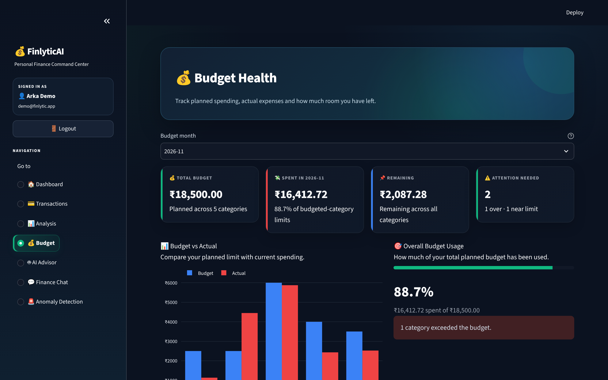
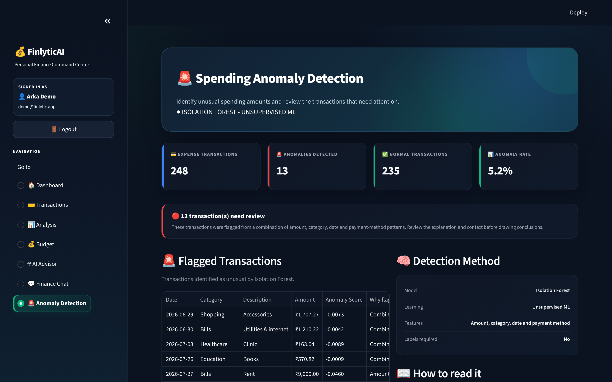
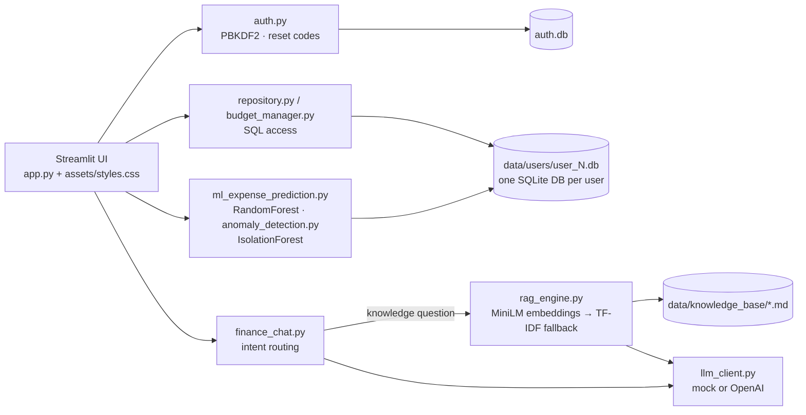

# 💰 Finlytic AI — Personal Finance Assistant with ML and RAG

[](https://github.com/arka829636/Finlytic-AI/actions)


A multi-user Streamlit app that turns a person's transactions into budgets, spending analytics, an expense forecast, explainable anomaly flags, and a **Finance Chat** that answers from both the user's own data and a local finance knowledge base (RAG). It runs fully offline by default (mock LLM + TF-IDF fallback), and can switch to a live OpenAI model with two environment variables.


## What it does

| Page | Highlights |
|---|---|
| **Dashboard** | Income, expenses, savings rate, top category, monthly cash flow, expense breakdown, next-day expense forecast with model-quality metrics |
| **Transactions** | Add / edit / delete transactions, filter and search |
| **Analysis** | Cash-flow trend, category breakdown, income vs expenses, filterable exploration, takeaways |
| **Budget** | Monthly category budgets with a **month selector**, budget-vs-actual, near-limit / over-budget status, unbudgeted spending report, budget create / update / delete, monthly history |
| **AI Advisor** | Transparent **rule-based** financial-health summary and recommendations (no LLM involved) |
| **Finance Chat** | Rule-based intent routing → exact answers from your data; knowledge questions go through RAG → LLM (or local mock) |
| **Anomaly Detection** | Isolation Forest over amount, category-relative amount, date, category and payment method, with a human-readable reason per flagged transaction |

Accounts are separate: registration, login, password reset, and one SQLite database per user.

<details><summary>More screenshots</summary>

| Budget | Finance Chat | Anomaly Detection |
|---|---|---|
|  |  |  |

</details>

## Architecture



Design notes and trade-offs: [`architecture.md`](architecture.md). Interview preparation: [`docs/INTERVIEW_GUIDE.md`](docs/INTERVIEW_GUIDE.md).

## Quick start

```bash
git clone https://github.com/arka829636/Finlytic-AI.git && cd Finlytic-AI
python -m venv .venv && source .venv/bin/activate      # Windows: .venv\Scripts\activate
pip install -r requirements.txt
cp .env.example .env                                   # keeps MOCK_LLM=true (no API key needed)
python -m streamlit run app.py
```

Register an account — it is seeded with a synthetic demo dataset (≈5 months, dates re-based so the newest record is today).

**Docker:** `docker build -t finlytic . && docker run -p 8501:8501 -v finlytic-data:/data finlytic`

**Live LLM:** set `OPENAI_API_KEY`, `OPENAI_MODEL`, and `MOCK_LLM=false` in `.env`.

The first semantic RAG query downloads `all-MiniLM-L6-v2`. If that is unavailable (offline, package missing), retrieval transparently falls back to TF-IDF.

## Tests

```bash
pip install -r requirements-dev.txt
python -m pytest -q        # 38 tests, ~10 s
```

Covers password hashing and legacy-hash upgrade, reset-code lockout, per-user database isolation, budget CRUD, demo-data re-basing, daily forecast aggregation and baseline comparison, anomaly explanations, RAG fallback, and an end-to-end Streamlit `AppTest` that registers, logs in, and renders every page. CI runs on Python 3.11–3.13.

## Engineering decisions worth knowing

- **Honest ML.** The forecast aggregates to daily totals (zero-spend days included), uses a chronological split, and is compared with a naive 7-day-average baseline; the UI says when the model does *not* beat it. Anomaly flags are described as signals, not proof.
- **Grounding.** Account numbers come from SQL and rule-based code, never from the LLM. The LLM only receives a summary plus retrieved reference text, with instructions not to invent figures.
- **Graceful degradation.** No API key → mock mode (labelled in the UI). No embedding model → TF-IDF. Relevance thresholds are tuned per retrieval mode.
- **Auth basics done properly.** PBKDF2-HMAC-SHA256 (600k iterations, versioned format, auto-upgrade of old hashes), constant-time comparison, hashed reset codes with expiry and attempt limit, HTML-escaped user input in custom markup.

## Known limitations

- SQLite per user suits a demo or small deployment, not horizontal scaling.
- No email service: in demo mode the reset code is shown on screen (`FINLYTIC_SHOW_RESET_CODE=false` hides it; a real deployment needs email delivery).
- The forecast needs ≥ 10 days of history and is only indicative on sparse data; Isolation Forest can flag legitimately large recurring payments (e.g. rent).
- No CSV import and no investment/goal-planning module yet (see roadmap).
- `app.py` is still a large single script; splitting pages into modules is the next refactor.

## Roadmap

CSV import · page-per-module refactor · source citations in chat answers · retrieval evaluation set · hybrid (BM25 + embedding) retrieval · email-based password reset · goal planning.

## Project layout

```
app.py                 Streamlit pages and navigation
assets/styles.css      Theme
src/
  auth.py              Registration, login, hashing, reset codes
  database.py          Per-user SQLite, demo seeding
  repository.py        Transaction / budget queries
  budget_manager.py    Budget upsert / delete with validation
  ml_expense_prediction.py   Daily RandomForest forecast + baseline
  anomaly_detection.py       Isolation Forest + explanations
  finance_chat.py      Intent detection and rule-based answers
  rag_engine.py        Chunking, embeddings, TF-IDF fallback
  llm_client.py        Mock / OpenAI client
scripts/generate_demo_data.py   Seeded synthetic dataset
tests/                 pytest suite
```

## Disclaimer

Educational portfolio project. Insights, forecasts and anomaly flags are not financial advice.

## Author

**Arka Mondal** — MCA student · Data Science · ML · RAG
